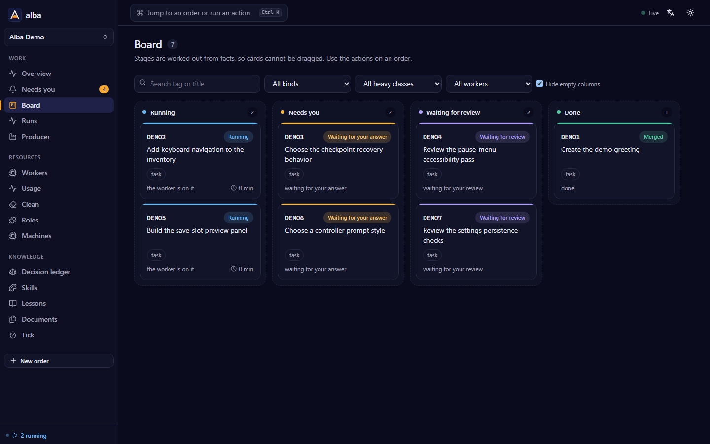
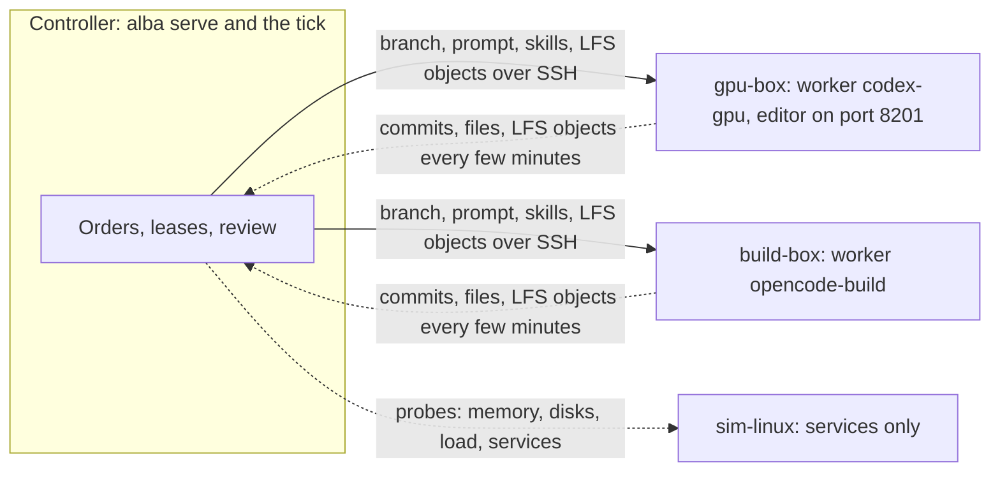

<p align="center">
  <picture>
    <source media="(prefers-color-scheme: dark)" srcset="docs/img/brand/alba-logo-dark.svg">
    
  </picture>
</p>

<p align="center">
  <a href="README.md">English</a> | <a href="README.zh-CN.md">简体中文</a> | <strong>日本語</strong>
</p>

# Alba

Alba は、1 台のワークステーションまたはローカルネットワーク上の複数マシンにまたがって、AI コーディングエージェントのチームを統括する**ローカル管制室（コントロールルーム）**です。文書化された**作業指示書（Order）**を独立した Git worktree に変換し、ハードウェア資源やサブスクリプション枠の制約を守りながら最適なエージェント CLI へルーティングし、実行状況をリアルタイムで監視し、**客観的な証拠がない限り一切マージしません**。



**ステータス：pre-1.0（0.1.0）、Apache-2.0 ライセンス。** 公開インターフェースの互換性と移行方針については [compatibility](docs/compatibility.md) を参照してください。

## なぜ Alba なのか

1 つのチャット画面で 1 つのコーディングエージェントを動かすスタイルは、小さな修正には十分です。しかし本格的なゲーム開発や大規模な C++ プロジェクトで複数エージェントを並列化しようとすると、すぐに限界が訪れます。同じフォルダでファイルを上書きし合い、並列ビルドでローカル RAM が枯渇し、複数のゲームウィンドウが同時に開いて画面キャプチャがフリーズし、深夜のうちに利用枠や従量課金 API クレジットを使い果たし、画面が壊れているのに終了コード `0` で「修正完了」と報告してきます。

Alba は場当たり的なチャット運用を、4 つのローカル制御レイヤーに置き換えます。

### 1. 事実駆動のワークフロー、事前検証、視覚的収束チェック

- **チャットではなく作業指示書とプリフライト検証。** すべてのタスクは、目的、依存関係、`allow:`/`deny:` による編集許可パス、検収基準を明記した Markdown の作業指示書です。種別ごとのテンプレート（`ue`、`code`、`docs`）が不足セクションを自動補完し、ディスパッチ前の**プリフライト検証（Preflight）**が検収項目の欠落や禁止パスの指定を検知して実行枠の浪費を防ぎます。ボード上のステージ（`queued`、`running`、`monitoring`、`awaiting-user`、`awaiting-review`、`merged`、`cancelled`）はローカル SQLite に追記された事実のみから算出されるため、カードを手動ドラッグして Git の実態と食い違うことはありません。[Orders, templates and preflight](docs/workflow/002-orders-and-stages.md)
- **1 実行 1 Worktree とアトミックな終了レシート。** 各ワーカーの試行（Run）には専用ブランチと独立した Git worktree が割り当てられます。終了時にはアトミックな終了レシートを記録して終了理由（`report`、`output-limit`、`context-limit`、`stream-cut-mid-turn`、`quota`、`vanished`）を正確に分類し、正常報告以外の終了では未コミット変更を `git stash` を使わずに `refs/alba/wip/*` へ自動退避します。[Runs and resume](docs/workflow/005-run-and-resume.md)
- **キャプチャレシピ、ビジュアルターゲット収束、異種モデル一次レビュー。** 終了コード `0` は承認を意味しません。Alba は検収リントの前にベースブランチをクリーンな worktree へ自動マージ（`auto_merge_base`）でき、`capture.recipes` を使えばマシンロック下で worktree 自体をビルド・起動して指定ショットを撮影し、ワーカー自身の提出画像よりも **Alba 自身のキャプチャ**を優先表示します。さらに `## Target` ブロックを宣言すると、ベースコミット上の参照画像（`git show <base>:<path>` で取得するためワーカーによる改ざんが不可能）に対して輝度・HSV 彩度・512 ビン RGB ヒストグラム距離・`16x9` セル構造コントラスト・フレーム間モーションの 5 指標を計測し、3 分割の差分シートを生成して `max_visual_rounds` 回まで自動差し戻しを行い、改善が止まれば `Not converging` として人間の判断を仰ぎます。また、実装ワーカーとは異なるモデルファミリー（`model_family`）の読み取り専用レビュアーに一次チェックを行わせる **First-pass review** も備えています。[Capture recipes](docs/workflow/037-capture-recipes.md)、[Visual targets](docs/workflow/038-visual-targets.md)、[First-pass review](docs/workflow/039-first-pass-review.md)、[Review](docs/workflow/006-review.md)、[Nightly gates](docs/operations/029-nightly-gates.md)

### 2. エージェント非依存のルーティング、サーキットブレーカー、レッスン予算

- **ワーカーの上位にあるルーティング層。** Codex、Claude Code、Antigravity CLI（`agy-cli`）、Grok CLI、OpenCode、独自スクリプトを単一ボードから統合駆動します。優先順位付きの**ワーカーグループ（Worker groups）**と**ルート（Routes）**によりタスク種別と個別 CLI を分離し、主力モデルの切り替えを設定 1 行の編集で完結させます（指示書単位の `--run-model` 指定にも対応）。[Routing](docs/workers/012-routing-and-skills.md#routing-worker-groups-and-routes)、[Workers](docs/workers/003-workers-and-quota.md)
- **クォータ連動ハンドオーバー、支出上限、サーキットブレーカー。** 複数 CLI 間で共有されるサブスクリプション枠を検知し、1 実行あたり（`max_minutes_per_run`、`max_usd_per_run`、`max_tokens_per_run`）および日次の USD 上限を強制します。ワーカーがレポートを残さず連続クラッシュした際は**サーキットブレーカー**が作動して一時停止し、実行中に利用枠へ達した指示書は引き継ぎ要約（Handoff brief）付きで次の待機ワーカーへ自動ローテーションします。[Hand-over](docs/workers/014-monitor-leases-loops.md#4-handing-an-order-over-when-a-worker-runs-out)、[Usage and cost](docs/console/020-usage-and-cost.md)
- **ライブ実行監視、スコープ付きスキル、レッスン予算管理（Lessons Diet）。** ストリーミングログ、ステップ進捗、トークン消費をリアルタイム表示し、稼働中のワーカーへ次のコミット後に読まれる受信箱メッセージを送れます。過去の失敗から得た教訓（Lessons）には優先度（`must` / `high` / `normal` / `low`）とバイト上限（既定 `6000` バイト・最大 `15` 件）が設けられ、プロンプト肥大化を防ぎつつ `alba lessons stats` で各教訓が初回承認率に与えた効果を定量評価できます。[Live runs](docs/workers/019-live-runs-and-messages.md)、[Lessons library](docs/workflow/011-decisions-questions-evidence-clean-credits-lessons.md#lessons-library)

### 3. ローカルワークステーションと LAN 複数マシンスケジューリング（Unreal・Unity・Godot・C++ 向け）

- **マシン横断リソースキュー、FIFO ロック、ゼロトークン監視（Monitor）。** 空き RAM 水準（`min_free_mem_gb`）を確認してからディスパッチし、`scope: machine` リソースによって同一 PC 上の複数プロジェクト間でビルド枠や GPU 枠を優先度付きキュー（`rework` 優先、次いで FIFO、過去 20 回の保持中央値から待機時間を推定）で共有します。時間のかかる Unreal のクックやパッケージ処理はバックグラウンドの **monitoring** ステージへ引き渡し、ワーカー枠を即座に解放して成果物完成後に元セッションを再開させます。[Monitors, leases and loops](docs/workers/014-monitor-leases-loops.md)
- **実行ごとのゲームエディタ MCP プール。** 新規 C++ worktree にバイナリがなく Unreal Editor が即終了する問題や、Windows 上で起動中のエディタが `.dll` をロックして再ビルドを妨げる問題に対し、マシンロック下での事前ビルド（`skip_if_newer`）、専用 MCP ポート（Unreal Engine 5.9 内蔵 MCP サーバーなど）のリース、ビルド前後の同一ポート停止・再開、プロセス作成時刻に基づく安全なツリー回収（PID 再利用事故を起こす `taskkill /T` は不使用）を提供します。[Run editors](docs/workers/032-run-editors.md)
- **デーモン不要の LAN SSH フリートと Unreal 環境展開。** リモート PC には標準の OpenSSH、Git、Node、エージェント CLI だけがあればよく、Alba 独自デーモンの常駐は不要です。SSH 経由のブランチ転送と**サーバーレスな Git LFS 差分同期**、約 3 分ごとのコミット・LFS 回収、ヘッドレスな Windows SSH セッションから実 GPU デスクトップ上でキャプチャやエディタを動かすデスクトップランナー（`DXGI_ERROR_NOT_CURRENTLY_AVAILABLE` を回避）、ハードウェア・ツールチェーン自動スキャン、さらに認証済みローカル Unreal インストールを **8 本の並列圧縮 SSH ストリーム**で別 PC へ高速コピーする機能を備えています。[複数マシンでのスケジューリング](#複数マシンでのスケジューリング)、[Unreal module](docs/engines/unreal.md)

### 4. 2D・3D・オーディオパイプライン向け宣言的ツールプラグイン

- **`alba-plugin.yaml` による一括バンドル。** 各 CLI 向けの MCP 起動フラグ、ツール許可リスト、専用 `SKILL.md`、環境変数名のみを参照する `env_from`（秘密値自体は設定ファイル・引数・プロンプト・ログに一切出力しない）、GPU メモリやウォレットの同時実行リースを 1 フォルダにまとめ、タスク種別ごとに必要な指示書へだけアタッチします（`image-gateway`、`tripo-3d`、`audio-studio` を同梱）。[Tool plugins](docs/workers/031-tool-plugins.md)
- **ワーカー不要のバッチ実行と「事前見積もり・承認後課金」台帳。** `alba tools run` により、コーディングエージェントの LLM トークンを一切消費せず JSON Schema 検証済みのアセット生成ジョブを直接実行できます。すべての有料呼び出しは指示書に紐づく**見積もり（Quote）**を作成し、アトミックな `auto_approve` 上限または人間によるキャップ承認（価格不明の上限見積もりは自動承認不可）を通過してから実行され、ウォレット残高差分とクラッシュセーフな記帳で暴走課金を防ぎます。

## 複数マシンでのスケジューリング

Alba は 1 台のコントローラー PC 上で動作します。**マシンレジストリ（`machines.yaml`）**に LAN 内の他マシンを登録し、`host` を指定した**ワーカー**がそのマシンへ SSH 接続してジョブを実行します。



```yaml
# machines.yaml
machines:
  - id: gpu-box
    name: GPU box
    os: windows
    connect: { ssh: gpu-box }          # ~/.ssh/config のエイリアス（秘密鍵はそのまま）
    workspace: <absolute folder>       # リモート側の worktree とベアリポジトリ配置先
    min_free_mem_gb: 6
    services:
      - id: compile-agent
        check: { process: compile-agent.exe }

# workers.yaml
workers:
  - id: codex-gpu
    engine: codex
    host: gpu-box                       # gpu-box 上で実行されるワーカー
    tunnel: 8000                        # 任意：コントローラー上のローカルゲートウェイへの SSH 逆トンネル
```

指示書が `codex-gpu` にディスパッチされる際の流れ：

1. スケジューラの Tick が、必要なプロジェクト単位またはマシン横断のリソースリースと同時実行枠を単一トランザクションで確保します。
2. Alba がクリーンなブランチをリモート側のベアリポジトリへ push し、専用 worktree をチェックアウトし、不足している Git LFS オブジェクトのみを転送（未展開の LFS ポインタが残っていないか検証）した上で、プロンプト・選択されたスキル・ロール設定・受信箱を配置します。
3. SSH 経由でワーカーを起動します。自動ログオン設定された Windows ホストでは、デスクトップランナーを介して実 GPU デスクトップ上でゲームキャプチャやエディタ MCP サーバーを開けます。
4. 約 3 分おき、および実行終了時にコミットと新規 Git LFS オブジェクトをコントローラーへ回収し、安全な場合のみローカルブランチを fast-forward し、分岐した履歴は Git ref として保持します。
5. 独立キャプチャ、ビジュアルターゲット計測、レビュー、マージはローカル実行とまったく同じ手順でコントローラー上で行われます。

現在リモートワーカーホストは Windows に対応しており、Linux および macOS マシンはヘルス・能力プローブ、ガイド付きツール導入、およびコントローラー自身の実行に対応しています。詳細は [Machines](docs/operations/028-machines.md#workers-on-another-machine) を参照してください。

## 5 分で試すクイックスタート（ローカルスクリプトのみ・モデル契約不要）

必要環境は **Node 24**、**pnpm 10.34.5**、**Git** です。組み込みデモはモデルアカウント、API キー、ゲームエンジンなしで完全にオフライン動作します：

```sh
pnpm install --frozen-lockfile
pnpm -C ui build
node examples/demo/run.ts
```

デモは作業指示書を 1 件作成し、独立した worktree へ `examples/demo/worker.mjs` をディスパッチし、レポートを取り込んでコミットを承認・マージし、HTTP コンソールの応答を検証します。

出力された一時ディレクトリを `<demo-directory>` に置き換えて Web コンソールを起動できます：

```sh
node bin/alba.mjs --project <demo-directory>/project/alba.yaml serve --port 0 --every 0
```

表示されたローカル URL をブラウザで開き（localhost は既定でサインイン不要。セッションキーを要求する場合は `--sign-in` を指定。詳細は [Access](docs/console/010-api.md#access)）、**Alba Demo** を選択してください。`Ctrl+C` で終了します。詳細は [デモガイド](examples/demo/README.md) を参照してください。

## パッケージとしてインストール・既存プロジェクトへの導入

リポジトリのチェックアウトからはビルド手順なしで TypeScript ソースを直接実行できます。npm パッケージとしてパックしてグローバル導入する場合：

```sh
pnpm pack
npm install --global ./baryon-interactive-alba-0.1.0.tgz
alba --help
```

自分のリポジトリ（任意のゲームエンジンや言語、単一 PC または複数マシン環境、Codex・Claude Code・Antigravity・OpenCode・Grok サブスクリプション対応）へ導入する手順は [Adopt Alba in your own project](docs/concepts/033-adopt-alba.md) を参照してください。

## コアコンセプト

| 用語 | 意味 |
|---|---|
| Order（作業指示書） | 目的、依存関係、編集範囲、検収基準を備えた境界明確なタスク定義 |
| Run（実行） | 専用ブランチと worktree 上で行われる 1 回のワーカー試行（PID 生成時刻と終了レシートを記録） |
| Worker（ワーカー） | 設定された計算リソース：エージェント CLI またはスクリプト、能力タグ、ホスト、利用枠、上限、起動テンプレート |
| Worker group（ワーカーグループ） | フォールバック順を持つワーカーの優先リスト |
| Route（ルート） | 作業種別と必要能力をワーカーグループへ結び付けるルール |
| Lease（リース） | プロジェクト内またはマシン横断の希少リソース（ビルド枠、エディタポート、GPU、ウォレット）に対するトランザクション予約 |
| Review（レビュー） | ブランチ差分、独立キャプチャ、ターゲット計測、証拠に基づく承認・差し戻し・キャンセル判断 |
| Gate（ゲート） | 条件未達時にディスパッチやマージを阻止するプリフライト・キャプチャ・ビジュアルターゲット・夜間テスト条件 |

## 対応プラットフォーム

| プラットフォーム | コントローラー・Web コンソール | リモート SSH ワーカーホスト | ネイティブ機能 |
|---|---|---|---|
| Windows | 対応（ローカルおよび CI で検証済み） | 対応 | プロセス作成時刻ベースのツリー終了、CIM プローブ、Junction を破壊しない安全な `clean`、デスクトップ GPU ランナー、タスクスケジューラ |
| Linux | 対応（実機 Linux および CI で検証済み） | プローブおよびツール導入に対応 | POSIX プロセスツリー終了、`/proc` プローブ、FIFO ロック、`systemd` タイマー |
| macOS | 対応（CI で検証済み） | プローブおよびツール導入に対応 | POSIX プロセスツリー終了、`sysctl`/`vm_stat` プローブ、FIFO ロック、`launchd` |

詳細は [プラットフォーム詳細](docs/platforms.md) を参照してください。

## オプションモジュール

以下のモジュールはすべて既定で無効化されており、`alba.yaml` に記述した機能のみが有効になります：

```yaml
producer:
  enabled: true
  session: { enabled: false }
design:
  enabled: true
art:
  dir: art
  format: alba
```

- **Producer（プロデューサー）**（[ドキュメント](docs/producer/023-producer-host.md)）：プロジェクトの事実から課題を整理し、ポリシー制御下のアクションを提案します（明示的に `auto` と設定したルールのみ自律実行）。
- **Design library（デザインライブラリ）**（[ドキュメント](docs/libraries/027-design-library.md)）：SQLite 上でゲームシステム、ルール、パラメータ、計測ターゲットを追跡します。
- **Art library（アートライブラリ）**（[ドキュメント](docs/libraries/015-art-library.md)）：ビジュアルリファレンス、設定カード、人間の選定（Picks）、クレジット台帳を管理します。
- **Engine modules（ゲームエンジンモジュール）**（[ドキュメント](examples/engines/README.md)）：Unreal、Unity、Godot 向けのオプトイン能力スキャンおよび環境構築支援モジュール（`engine: unreal | unity | godot`）。

## ドキュメント

まずは [ドキュメント索引](docs/README.md) からご覧ください。主要リファレンス：[設計思想](docs/concepts/000-philosophy.md)、[既存プロジェクトへの導入](docs/concepts/033-adopt-alba.md)、[キャプチャレシピ](docs/workflow/037-capture-recipes.md)、[ビジュアルターゲット](docs/workflow/038-visual-targets.md)、[一次レビュー](docs/workflow/039-first-pass-review.md)、[マシン管理](docs/operations/028-machines.md)、[Unreal モジュール](docs/engines/unreal.md)、[実行ごとのエディタプール](docs/workers/032-run-editors.md)、[ツールプラグイン](docs/workers/031-tool-plugins.md)、[ワーカーアダプタ仕様](docs/worker-adapters.md)、[HTTP API](docs/console/010-api.md)、[コントリビュート案内](CONTRIBUTING.md)。

## データとプライバシー

Alba には**テレメトリ（外部送信機能）が一切ありません**。SQLite ステート、ログ、プロンプト、レポート、会話履歴、承認記録はすべて指定したローカルディレクトリ内に保存され、コンソールの表示設定はブラウザのローカルストレージにのみ保持されます。

コントローラーマシンの外へ出る通信は、ユーザーが明示的に設定したものに限られます：

- ワーカー CLI および有効化したツールプラグインが、設定されたモデルサービスやローカルゲートウェイへ送信するプロンプト・ファイル・ツール呼び出し。
- 登録したリモート SSH マシンとの間で送受信するヘルスプローブ、ブランチ履歴、worktree ファイル、不足分の Git LFS オブジェクト、プロンプト、選択されたスキル、および回収されるコミット・変更ファイル・レポート。
- 外部ドキュメントリンクを開いた際、またはアートリファレンスのダウンロードを要求した際の対象 HTTPS 通信。

ワーカーは通常の環境変数を継承しますが、内部用の `ALBA_*` 設定およびコンソール・サービストークンは自動的に除去されます（`launch.env_unset` でさらに制限可能）。詳細は [セキュリティとプライバシー](docs/security-and-privacy.md) および [脆弱性の非公開報告](SECURITY.md) を参照してください。

## ライセンス

ソースコードは [Apache-2.0](LICENSE) ライセンスの下で公開されています（Copyright Baryon Interactive）。**Alba の名称およびロゴはライセンス許諾の対象外です**（詳細は [NOTICE](NOTICE) を参照）。サードパーティ製ランタイム依存関係は[それぞれのライセンスと表記](docs/third-party-licenses.md)に従います。
