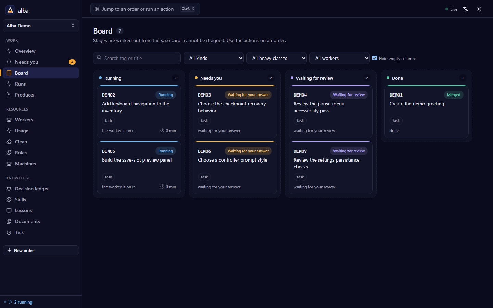
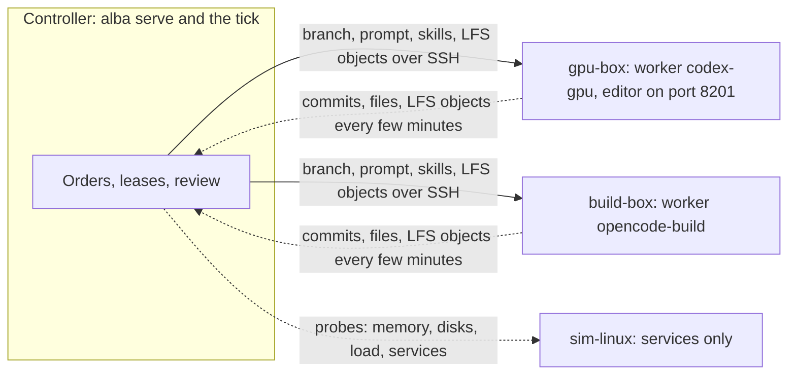

<p align="center">
  <picture>
    <source media="(prefers-color-scheme: dark)" srcset="docs/img/brand/alba-logo-dark.svg">
    
  </picture>
</p>

# Alba

Alba is a local control room for a team of coding agents. It turns work orders into isolated Git worktrees, sends each one to the
right worker on the right machine, watches the run live and accepts nothing without evidence.



**Status: pre-1.0 (0.1.0).** Public contracts and migration expectations are documented in [compatibility](docs/compatibility.md).

## What it does

- **Work orders, not chat.** Each task is an order with intent, dependencies and acceptance criteria. Its stage is worked out from
  facts (commits, reports, decisions), so the board cannot drift from what happened. [Orders and stages](docs/workflow/002-orders-and-stages.md)
- **One worktree per run.** Every run gets its own branch and worktree, so parallel workers never step on each other, and a review
  looks at exactly what the worker committed. [Runs and resume](docs/workflow/005-run-and-resume.md)
- **Routing above the workers.** Worker groups are ordered lists of workers with a fallback: the first that can start takes the
  order, then the next. Routes send each kind of work to a group, so "Codex first everywhere" is one edit of one group, and workers
  you never want chosen are listed once. [Routing](docs/workers/012-routing-and-skills.md#routing-worker-groups-and-routes)
- **Scheduling across workers and machines.** A tick picks the next orders and the worker for each: by route, capability, quota left,
  daily spend, concurrency, shared resources and caps. A worker can live on another machine; Alba ships the work there over SSH and
  brings the commits back. [Scheduling across machines](#scheduling-across-machines)
- **Quota-aware hand-over.** When a worker's usage window runs out or its service is at capacity, the order waits for it or goes to the
  next suitable worker with a hand-over brief; a paid worker is used only when allowed. [Hand-over](docs/workers/014-monitor-leases-loops.md#4-handing-an-order-over-when-a-worker-runs-out)
- **Long jobs and stuck runs.** A cook or package step can be handed to a monitor so it does not hold a worker slot. Runs that stop
  committing, loop on the same error or never write a start receipt are flagged. [Monitors, leases and loops](docs/workers/014-monitor-leases-loops.md)
- **Live runs.** The console shows each run's current command, plan, tokens and messages as they happen, and you can leave a note the
  worker reads after its next commit. [Live runs](docs/workers/019-live-runs-and-messages.md)
- **Review by evidence.** A worker's exit code approves nothing. A delivery shows its report, diff, acceptance evidence and merge
  readiness; an optional pipeline checks, verifies independently and merges, and nightly gates run the expensive suites once per
  batch. [Review](docs/workflow/006-review.md), [acceptance pipeline](docs/workflow/026-acceptance-pipeline.md), [nightly gates](docs/operations/029-nightly-gates.md)
- **Skills and lessons.** Skills are attached by kind, by order or by a tool, and a run sees only the skills Alba chose for it; the
  prompt carries the lessons that share a tag with the order. [Skills](docs/workers/012-routing-and-skills.md#skills)
- **Tool plugins and spend.** Image, 3D and other paid services come in as plugins with their MCP server, skill and resources; a paid
  call is quoted first and waits for approval. [Tool plugins](docs/workers/031-tool-plugins.md), [usage and cost](docs/console/020-usage-and-cost.md)
- **An optional producer.** A policy-gated assistant turns facts into cases and proposed actions, and acts by itself only where your
  policy says `auto`. [Producer](docs/producer/021-producer.md)

## Scheduling across machines

Alba runs on one computer, the controller. A **machine registry** lists the others, and a **worker** with a `host` runs on that
machine. The controller decides what runs where; a worker host needs SSH, Git, Node and the worker's own CLI, and no Alba agent.



```yaml
# machines.yaml
machines:
  - id: gpu-box
    name: GPU box
    os: windows
    connect: { ssh: gpu-box }          # an alias in your SSH config; keys stay there
    workspace: <absolute folder>       # where its worktrees and bare repositories go
    min_free_mem_gb: 6
    services:
      - id: compile-agent
        check: { process: compile-agent.exe }

# workers.yaml
workers:
  - id: codex-gpu
    engine: codex
    host: gpu-box                       # this worker runs on gpu-box
    tunnel: 8000                        # optional: a reverse tunnel to a model gateway on the controller
```

When an order goes to `codex-gpu`:

1. The tick chooses the order and the worker as for any run, and takes the leases and cap slots the order needs.
2. Alba pushes the clean worktree's branch to a bare repository on the host, checks out a host worktree, copies the Git LFS objects
   the host lacks, and stages the prompt, skills, role configuration and inbox there.
3. The worker starts over SSH. On a Windows host a run can still open windows on the logged-on desktop, for example a game capture
   or the editor, although an SSH session has none.
4. About every three minutes, and at the end, Alba fetches the commits back, copies new LFS objects and fast-forwards the local branch
   only when that is safe. Divergent work is kept as refs, never overwritten.
5. Review, merge and approval happen on the controller, as for a local run.

Around that:

- **Health at a glance.** Probes read memory, disks, load and service checks of every machine, keep 24 hours of history, and raise a
  problem when a machine is down or short of memory or disk.
- **Capability scan.** A read-only scan finds the CPU, GPU, memory and tools (Git, LFS, Python, CMake, compilers, Node, Docker) and,
  when you select an engine, its Unreal, Unity or Godot install. It suggests roles for the machine and names what is missing.
- **Add and set up from the board.** A guide prepares the SSH server and key, writes the SSH config, tests the connection and appends
  the machine. Missing tools are installed from a plan you approve first (winget, apt or dnf, Homebrew); the Unreal module can also
  copy the engine over in eight parallel compressed streams.
- **An editor per run, on the right machine.** An editor pool gives a run its own game editor with an MCP server on a port of the run's
  machine, prepares the worktree first (for example, compiles the game module) and stops the editor when the run ends.
  [Run editors](docs/workers/032-run-editors.md)
- **Shared resources and caps.** Build lanes, packaging slots and exclusive performance machines are leases; a run that needs one
  waits for it, and a lease that outlives its run is flagged. [Resources and leases](docs/workers/014-monitor-leases-loops.md#2-resources-and-leases)
- **The fleet map.** The console's Machines page draws the controller and every machine, which workers live where and which runs are
  out on them right now.

Remote worker hosts are Windows today. Linux and macOS machines can be probed, scanned and given installs, and the controller runs on
Windows, Linux or macOS. Placement is explicit: a worker's `host` decides where it runs; machine roles and slots are information for
people. Details: [Machines](docs/operations/028-machines.md#workers-on-another-machine).

## Who it is for

For individual developers and small teams coordinating several coding workers, especially game projects with scarce build capacity or model quotas. Workers can be local scripts or explicitly configured agent CLIs. The demo needs no model account.

## Platform support

| Platform | Implementation | Test coverage |
|---|---|---|
| Windows | Process identity/tree cleanup, machine probes, service locks, Task Scheduler | Backend and console tested locally |
| Linux | POSIX process identity/tree cleanup, probes, locks, systemd timer | Backend and console tested on native Linux |
| macOS | POSIX process identity/tree cleanup, probes, locks, launchd | Covered by CI |

Requires Node 24, pnpm 10.34.5 and Git. See [platform details](docs/platforms.md).

## Quick start: five minutes, local scripts only

In a clean Alba checkout:

```sh
pnpm install --frozen-lockfile
pnpm -C ui build
node examples/demo/run.ts
```

Expect a printed disposable demo directory and accepted commit. The demo creates an order, dispatches `examples/demo/worker.mjs` into a worktree, ingests its report, merges and approves its commit, and checks the HTTP console. No model, remote worker, credential or engine is needed.

Copy the printed directory in place of `<demo-directory>`:

```sh
node bin/alba.mjs --project <demo-directory>/project/alba.yaml serve --port 0 --every 0
```

Open the address printed by `serve` (no sign-in on your own machine; `--sign-in` asks for a key, see [Access](docs/console/010-api.md#access)). Select **Alba Demo** to inspect the merged greeting order. Stop with Ctrl+C. The demo lives in the checkout's ignored `.alba/demo` folder; after stopping the service, its printed directory can be deleted. See [the demo guide](examples/demo/README.md).

## Install as a package

A checkout runs the TypeScript sources directly, with nothing to build. Alba can also be installed as an npm package, for example from a tarball made with `npm pack` (or `pnpm pack`) in a checkout:

```sh
npm install --global ./baryon-interactive-alba-0.1.0.tgz    # or: pnpm add <tarball>, npm install <tarball> in a project
alba --help
```

Node does not strip types under `node_modules`, so packing builds the JavaScript first: `prepack` runs `scripts/build.mjs`, which compiles `src/` to `dist/`, copies the helper scripts beside it and builds the console (`ui/dist`) when the console's dependencies are installed (`pnpm install`). `bin/alba.mjs` runs `src/` when it is there and `dist/` otherwise. `pnpm build` runs the same build by hand; a checkout does not need it.

To use Alba with your own repository (any engine, one machine, a Codex or Claude subscription), follow [Adopt Alba in your own project](docs/concepts/033-adopt-alba.md).

## Core concepts

| Concept | Meaning |
|---|---|
| Order | A bounded task with intent, dependencies and acceptance criteria |
| Run | One worker attempt on an order, recorded with process identity and outcome |
| Worker | Configured compute supply: CLI/script, capabilities, quota and launch template |
| Worker group | An ordered list of workers with a fallback; the layer routes draw on |
| Route | Sends kinds of work to a worker group, with the capabilities they need |
| Review | A decision based on the report, committed changes and acceptance evidence |
| Gate | A deterministic condition that blocks dispatch or approval when unmet |

A successful worker exit does not approve an order. [Workflow reference](docs/workflow/002-orders-and-stages.md) describes stage inference and report blocks.

## Optional modules

All three modules below are disabled when omitted. Add only the sections you need to `alba.yaml`:

```yaml
producer:
  enabled: true
  session: { enabled: false }
design:
  enabled: true
art:
  dir: art
  format: alba
```

The [producer](docs/producer/023-producer-host.md) stores cases and policy-gated actions; a model session requires separate explicit configuration. The [design library](docs/libraries/027-design-library.md) uses SQLite to track systems, rules, parameters and measured targets. The [art library](docs/libraries/015-art-library.md) reads references and setting cards from the configured folder; picks and credit records have separate opt-in sections. No game engine is selected implicitly; [engine modules](examples/engines/README.md) are optional.

## Documentation

Start at the [documentation index](docs/README.md). See [worker adapters](docs/worker-adapters.md), [library formats](docs/library-formats.md), [HTTP API](docs/console/010-api.md), [scheduling](examples/scheduling.md) and [contributing](CONTRIBUTING.md) for development checks.

## Data and privacy

Alba has **no telemetry**. Configuration selects the repository, work-order folder, state directory and worktree parent. SQLite records, logs, prompts, reports, conversations and approvals stay there; console preferences and drafts use browser local storage.

The following can leave the machine:

- Worker engines send prompts, code and tool results to their configured model services or gateways.
- User-configured remote machines receive SSH probes and configured commands. Remote workers also receive branch history, worktree code, order/prompt files, selected skills and explicit worker settings, and return commits, changed files and reports.
- External document links and remote images contact their destination when opened or rendered; requested art-reference downloads contact their selected HTTPS source.

Other Alba processing and state stay local. User-configured programs control their own network activity; dependency installation contacts the configured package registry. The demo contacts no service. Workers inherit ordinary environment variables, including model credentials, but inherited `ALBA_*` settings and console/service tokens are removed. Explicit adapter protocol values are added; use `launch.env_unset` to restrict other variables. See [security and privacy](docs/security-and-privacy.md) and [private vulnerability reporting](SECURITY.md).

## License

Source code is licensed under [Apache-2.0](LICENSE), copyright Baryon Interactive. **The Alba name and logo are excluded from the license grant**; see [NOTICE](NOTICE). Dependencies retain their [own licenses and notices](docs/third-party-licenses.md).
