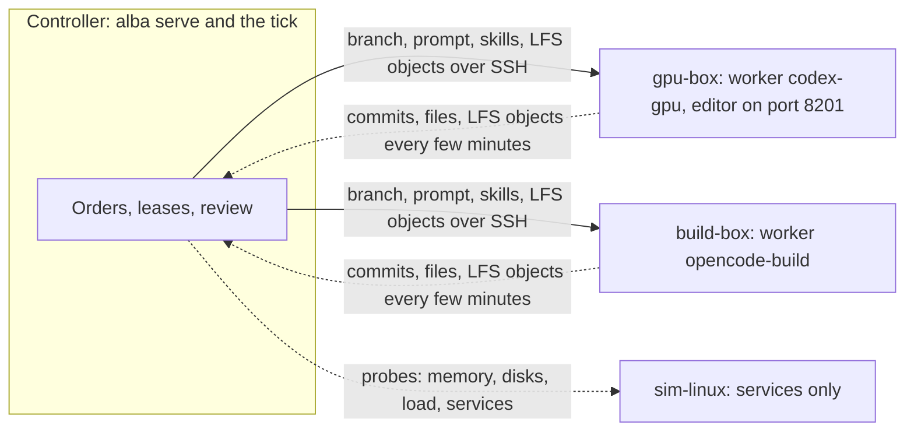

<p align="center">
  <picture>
    <source media="(prefers-color-scheme: dark)" srcset="docs/img/brand/alba-logo-dark.svg">
    
  </picture>
</p>

<p align="center">
  <strong>English</strong> | <a href="README.zh-CN.md">简体中文</a>
</p>

# Alba

Alba is a local control room for coordinating a team of AI coding agents across one workstation or a local fleet of machines. It turns written work orders into isolated Git worktrees, routes each task to the right agent CLI under hardware and quota guardrails, watches runs live, and merges nothing without independent evidence.


**Status: pre-1.0 (0.1.0), Apache-2.0.** Public contracts and migration expectations are documented in [compatibility](docs/compatibility.md).

## Why Alba

Running one coding agent in one chat window works for small edits. On a real game or C++ codebase, parallel agents overwrite each other's files, starve local RAM during builds, freeze screen captures when two game windows open at once, burn through subscription windows or API credits overnight, and report "done" when nothing works on screen.

Alba replaces ad-hoc chat loops with four layers of local control:

### 1. Fact-driven workflow, preflight gates, and visual verification

- **Work orders, templates, and preflight.** Every task is a Markdown order with intent, dependencies, `allow:`/`deny:` file boundaries, and acceptance criteria. Per-kind templates (`ue`, `code`, `docs`) fill missing sections on creation, and preflight checks hold malformed orders before a worker run is spent. Card stages (`queued`, `running`, `monitoring`, `awaiting-user`, `awaiting-review`, `merged`, `cancelled`) are computed from append-only facts in SQLite, so cards cannot drift out of sync with Git. [Orders, templates and preflight](docs/workflow/002-orders-and-stages.md)
- **One worktree per run and atomic end receipts.** Each worker attempt gets its own branch and Git worktree. Finished runs write atomic exit receipts classifying exact end causes (`report`, `output-limit`, `context-limit`, `stream-cut-mid-turn`, `quota`, `vanished`), and any non-report exit snapshots uncommitted files into `refs/alba/wip/*` without touching `git stash`. [Runs and resume](docs/workflow/005-run-and-resume.md)
- **Capture recipes and visual target convergence.** A clean exit code approves nothing. With `capture.recipes`, Alba builds and launches the order's worktree itself under a machine lock, runs blank/dark/duplicate/luminance/motion gates, and places **Alba's captures** ahead of worker screenshots. Orders with a `## Target` block compare shots against base-commit reference images (`luminance`, `saturation`, 512-bin RGB `histogram`, `16x9` `structure`, and `motion`), generate a three-panel diff sheet, automatically bounce misses up to `max_visual_rounds`, and escalate `Not converging` with round trend history when progress stalls. [Capture recipes](docs/workflow/037-capture-recipes.md), [visual targets](docs/workflow/038-visual-targets.md), [review](docs/workflow/006-review.md), [nightly gates](docs/operations/029-nightly-gates.md)

### 2. Agent-agnostic routing, circuit breakers, and bounded lessons

- **Routing above the workers.** Drives Codex, Claude Code, Antigravity CLI (`agy-cli`), Grok CLI, OpenCode, or local scripts from one board. Ordered **worker groups** and **routes** decouple task kinds from specific CLIs (with optional per-order `--run-model` overrides), making model rerouting a one-line edit. [Routing](docs/workers/012-routing-and-skills.md#routing-worker-groups-and-routes), [workers](docs/workers/003-workers-and-quota.md)
- **Quota-aware hand-over, spend caps, and circuit breakers.** Detects shared subscription pools across CLIs, enforces per-run (`max_minutes_per_run`, `max_usd_per_run`, `max_tokens_per_run`) and daily USD caps, trips a temporary circuit breaker when a worker repeatedly dies without a report, and rotates capacity-limited orders to fallback workers with a generated hand-over brief. [Hand-over](docs/workers/014-monitor-leases-loops.md#4-handing-an-order-over-when-a-worker-runs-out), [usage and cost](docs/console/020-usage-and-cost.md)
- **Live runs, scoped skills, and bounded lessons.** Watch streaming logs, step progress, and token usage live; leave inbox notes read after the next commit; mount matching skills plus priority-ranked tagged lessons within a strict byte budget (`max_bytes: 6000`, `max_items: 15`), and measure first-pass acceptance lift per lesson with `alba lessons stats`. [Live runs](docs/workers/019-live-runs-and-messages.md), [lessons library](docs/workflow/011-decisions-questions-evidence-clean-credits-lessons.md#lessons-library)

### 3. Local workstation and LAN machine scheduling (built for Unreal, Unity, Godot, and C++)

- **Machine-wide resource queues, FIFO locks, and zero-token monitors.** Gate dispatches on live free-RAM floors, share `scope: machine` resource pools across multiple projects on the same workstation (`rework` prioritized ahead of `new`, with median wait estimates), serialize single-window GPU captures with FIFO locks, and hand slow cook/package steps to a background **monitor** so the worker slot frees up immediately until the build finishes. [Monitors, leases and loops](docs/workers/014-monitor-leases-loops.md)
- **Per-run game editor MCP pools.** Compile a fresh C++ worktree under lock first (`skip_if_newer`), lease a dedicated game editor port (such as Unreal Engine 5.9's built-in MCP server), pause/restart around Windows `.dll` binary locks, and clean up process trees by PID creation timestamp. [Run editors](docs/workers/032-run-editors.md)
- **Zero-daemon SSH fleet and Unreal provisioning.** Dispatch branches and serverless Git LFS deltas over standard SSH to spare Windows PCs on your desk, run GPU captures/editors inside the logged-on desktop session, scan hardware/toolchains, and copy a licensed local Unreal install across LAN in eight parallel compressed streams. [Scheduling across machines](#scheduling-across-machines), [Unreal module](docs/engines/unreal.md)

### 4. Tool plugins for 2D, 3D, and audio pipelines

- **Declarative `alba-plugin.yaml` bundles.** Package cross-CLI MCP server flags, tool allowlists, scoped `SKILL.md` guides, `env_from` secret variable names (never values), and GPU/wallet leases into one unit attached by order kind (`image-gateway`, `tripo-3d`, `audio-studio`). [Tool plugins](docs/workers/031-tool-plugins.md)
- **Workerless batch operations and quote-before-spend.** Run schema-checked asset jobs directly via `alba tools run` without spending coding-agent LLM tokens. Every paid call is priced and gated by an order-bound quote (human-approved or capped by atomic `auto_approve` limits), with crash-safe wallet accounting.

## Scheduling across machines

Alba runs on one computer, the controller. A **machine registry** lists your other local or LAN machines, and a **worker** with a `host` runs on that machine over SSH. Worker hosts need only SSH, Git, Node, and the worker's CLI; no Alba daemon is installed on remote machines.



```yaml
# machines.yaml
machines:
  - id: gpu-box
    name: GPU box
    os: windows
    connect: { ssh: gpu-box }          # an alias in your SSH config; keys stay there
    workspace: <absolute folder>       # where its worktrees and bare repositories go
    min_free_mem_gb: 6
    services:
      - id: compile-agent
        check: { process: compile-agent.exe }

# workers.yaml
workers:
  - id: codex-gpu
    engine: codex
    host: gpu-box                       # this worker runs on gpu-box
    tunnel: 8000                        # optional: reverse tunnel to a local gateway on the controller
```

When an order dispatches to `codex-gpu`:

1. The tick claims the required project or machine-wide resource leases and concurrency slots in one transaction.
2. Alba pushes the clean branch to a bare repository on the host, checks out an isolated host worktree, transfers only missing Git LFS objects (verifying no unsmudged pointers remain), and stages the prompt, selected skills, role config, and inbox.
3. The worker launches over SSH. On a logged-on Windows host, runs can still open GPU windows on the desktop (for game captures, packaged smoke runs, or an editor MCP server) via Alba's desktop runner.
4. Roughly every three minutes and at exit, Alba fetches commits and new Git LFS objects back, fast-forwarding local branches only when safe and keeping divergent commits as refs.
5. Independent captures, visual target checks, review, and merge happen on the controller identically to local runs.

Remote worker hosts are Windows today; Linux and macOS machines support health/capability probes, guided tool installation, and running the controller itself. Details: [Machines](docs/operations/028-machines.md#workers-on-another-machine).

## Quick start: five minutes, local scripts only

Requires **Node 24**, **pnpm 10.34.5**, and **Git**. The built-in demo runs offline with zero model accounts, API keys, or game engines:

```sh
pnpm install --frozen-lockfile
pnpm -C ui build
node examples/demo/run.ts
```

The demo creates an order, dispatches `examples/demo/worker.mjs` into an isolated worktree, ingests its report, merges and approves its commit, and verifies the HTTP console.

Open the demo in the web console (replacing `<demo-directory>` with the printed path):

```sh
node bin/alba.mjs --project <demo-directory>/project/alba.yaml serve --port 0 --every 0
```

Visit the printed loopback URL (no sign-in required on localhost; pass `--sign-in` to require a session key, see [Access](docs/console/010-api.md#access)) and select **Alba Demo**. Stop with `Ctrl+C`. See [the demo guide](examples/demo/README.md).

## Install as a package

A checkout runs TypeScript sources directly with no build step. To pack and install globally:

```sh
pnpm pack
npm install --global ./baryon-interactive-alba-0.1.0.tgz
alba --help
```

To set up Alba on your own repository (any game engine or language, single machine or multi-machine fleet, with Codex, Claude Code, Antigravity, OpenCode, or Grok subscriptions), follow [Adopt Alba in your own project](docs/concepts/033-adopt-alba.md).

## Core concepts

| Concept | Meaning |
|---|---|
| Order | A bounded task with intent, dependencies, scope, and acceptance criteria |
| Run | One worker attempt on an order in its own branch and worktree, tracked with PID identity and exit receipt |
| Worker | Configured compute supply: agent CLI or script, capabilities, host, quota, caps, and launch template |
| Worker group | An ordered preference list of workers with fallbacks |
| Route | Maps work kinds and required capabilities to a worker group |
| Lease | A transactional reservation on a project or machine-wide resource (builds, editors, GPUs, wallets) |
| Review | An approval, rework, or cancel decision backed by diffs, independent captures, target metrics, and evidence |
| Gate | A preflight, capture, visual-target, or nightly condition that blocks dispatch or merge when unmet |

## Platform support

| Platform | Controller and console | Remote SSH worker host | Native features |
|---|---|---|---|
| Windows | Supported (tested locally and in CI) | Supported | Process creation-time tree cleanup, CIM probes, junction-safe `clean`, desktop GPU runner, Task Scheduler |
| Linux | Supported (tested on native Linux and CI) | Probes and tool installs | POSIX process tree cleanup, `/proc` probes, locks, `systemd` timer |
| macOS | Supported (covered by CI) | Probes and tool installs | POSIX process tree cleanup, `sysctl`/`vm_stat` probes, locks, `launchd` |

See [platform details](docs/platforms.md).

## Optional modules

All optional modules are off until configured in `alba.yaml`:

```yaml
producer:
  enabled: true
  session: { enabled: false }
design:
  enabled: true
art:
  dir: art
  format: alba
```

- **Producer** ([docs](docs/producer/023-producer-host.md)): Turns project facts into cases and policy-gated action proposals; acts autonomously only on rules explicitly set to `auto`.
- **Design library** ([docs](docs/libraries/027-design-library.md)): SQLite-backed tracking for game systems, rules, parameters, and measured targets.
- **Art library** ([docs](docs/libraries/015-art-library.md)): Manages visual references, setting cards, human picks, and credit ledgers.
- **Engine modules** ([docs](examples/engines/README.md)): Opt-in capability scans and provisioning helpers for Unreal, Unity, and Godot (`engine: unreal | unity | godot`).

## Documentation

Start at the [documentation index](docs/README.md). Key references: [philosophy](docs/concepts/000-philosophy.md), [adopt Alba](docs/concepts/033-adopt-alba.md), [capture recipes](docs/workflow/037-capture-recipes.md), [visual targets](docs/workflow/038-visual-targets.md), [machines](docs/operations/028-machines.md), [Unreal module](docs/engines/unreal.md), [run editors](docs/workers/032-run-editors.md), [tool plugins](docs/workers/031-tool-plugins.md), [worker adapters](docs/worker-adapters.md), [HTTP API](docs/console/010-api.md), and [contributing](CONTRIBUTING.md).

## Data and privacy

Alba has **no telemetry**. SQLite state, logs, prompts, reports, conversations, and approvals stay in your configured local directories; console preferences stay in browser local storage.

Only what you explicitly configure leaves the controller machine:

- Worker CLIs and enabled tool plugins send prompts, files, and tool calls to their configured model services or local gateways.
- Configured SSH machines receive health probes, branch history, worktree files, missing Git LFS objects, prompts, and selected skills, and return commits, changed files, and reports.
- Opening external links or requesting art-reference downloads contacts those HTTPS URLs.

Workers inherit standard environment variables, while internal `ALBA_*` settings and console/service tokens are stripped automatically; use `launch.env_unset` to restrict additional variables. See [security and privacy](docs/security-and-privacy.md) and [private vulnerability reporting](SECURITY.md).

## License

Source code is licensed under [Apache-2.0](LICENSE), copyright Baryon Interactive. **The Alba name and logo are excluded from the license grant**; see [NOTICE](NOTICE). Third-party runtime dependencies retain their [own licenses and notices](docs/third-party-licenses.md).
