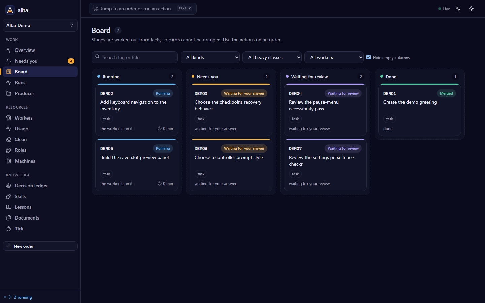
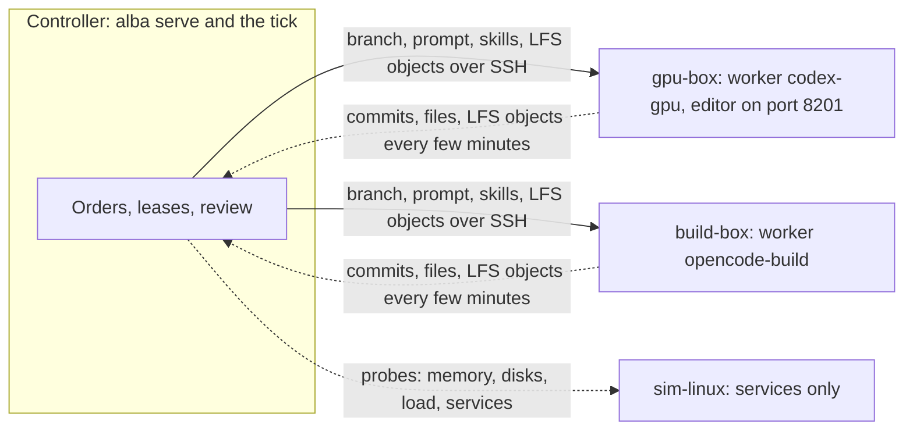

<p align="center">
  <picture>
    <source media="(prefers-color-scheme: dark)" srcset="docs/img/brand/alba-logo-dark.svg">
    
  </picture>
</p>

<p align="center">
  <a href="README.md">English</a> | <strong>简体中文</strong>
</p>

# Alba

Alba 是面向 AI 编程智能体团队的**本地中控室**，可在单台开发工作站或局域网多台电脑上协同调度多个智能体。它把书面**工单（Order）**转化为相互隔离的 Git 工作树（Worktree），在硬件资源与订阅额度护栏下将任务路由给最合适的智能体 CLI，实时监控运行进展，并坚持**无独立证据不合并**。



**当前状态：pre-1.0（0.1.0），Apache-2.0 开源许可。** 公共契约与版本演进规则见 [compatibility](docs/compatibility.md)。

## 为什么需要 Alba

用单个聊天窗口驱动一个编程智能体做小改动很顺手；但一旦进入真实的游戏工程或大型 C++ 项目，单窗口和手工多开很快会撞上瓶颈：并行智能体互相覆盖文件、两个编译任务吃光本机内存、多开游戏窗口导致截屏卡死、半夜耗尽订阅窗口甚至悄悄烧掉按量 API 账单、智能体退出码为 `0` 嘴上说“修好了”但打包出来的画面根本没动。

Alba 用四层本地工程控制取代松散的聊天循环：

### 1. 事实驱动的工作流、派工前预检与视觉收敛验收

- **工单模板与派工前预检（Preflight）。** 每项任务都是一份带明确意图、前置依赖、`allow:`/`deny:` 文件边界与验收标准的 Markdown 工单。创建工单时可按种类（`ue`、`code`、`docs`）自动补齐模板段落；派工前自动预检缺失验收项、越界路径与前置依赖，不合格工单直接挂起（`preflight-held`），不白白消耗运行名额。看板阶段（`queued`、`running`、`monitoring`、`awaiting-user`、`awaiting-review`、`merged`、`cancelled`）完全由本地 SQLite 中的追加事实自动推算，卡片不可手动拖拽。见 [工单、模板与预检](docs/workflow/002-orders-and-stages.md)。
- **每次派工独立工作树与原子结束回执。** 每一次工人尝试（Run）都拥有独立分支与 Git 工作树；运行结束写入原子退出回执，精确区分正常提交报告、输出长度截断（`output-limit`）、上下文触顶（`context-limit`）、流中断、额度耗尽或进程消失，且所有非正常报告退出都会自动将未提交改动快照至 `refs/alba/wip/*`。见 [派工与续跑](docs/workflow/005-run-and-resume.md)。
- **独立抓图配方（Capture Recipes）与视觉目标自动收敛（Visual Targets）。** 进程退出码为 `0` 不代表通过。配置 `capture.recipes` 后，Alba 会在机器锁下亲自编译并启动该工单的工作树，抓取指定镜头并执行黑屏、纯色、重复帧、亮度与帧间运动门禁，在审查卡片上将 **Alba 亲自抓取的画面**排在工人自报截图之前。工单还可声明 `## Target` 段落，直接从基线提交读取参考图（`git show <base>:<path>`，防止工人篡改目标图），综合测量亮度、HSV 饱和度、512 桶 RGB 直方图距离、`16x9` 网格结构对比度与运动量，生成“参考图 · 实拍图 · 网格差值图”三联对比表，在 `max_visual_rounds` 轮次内自动打回偏差项并追踪收敛趋势（`closer` / `farther` / `stalled`），连续停滞时自动升级为 `Not converging` 交由人工裁决。见 [抓图配方](docs/workflow/037-capture-recipes.md)、[视觉目标与自动收敛](docs/workflow/038-visual-targets.md)、[验收审查](docs/workflow/006-review.md)、[夜间门禁](docs/operations/029-nightly-gates.md)。

### 2. 无关智能体框架的路由、熔断器与教训预算

- **在工人之上做路由。** 同一块看板可混编驱动 Codex、Claude Code、Antigravity CLI（`agy-cli`）、Grok CLI、OpenCode 或自定义本地脚本。通过有序**工作组（Worker groups）**与**路由（Routes）**解耦工单种类与具体 CLI（也支持按单指定 `--run-model`），切换主力模型只需改一行配置，在途工作树零中断。见 [路由与技能](docs/workers/012-routing-and-skills.md#routing-worker-groups-and-routes)、[工人与额度](docs/workers/003-workers-and-quota.md)。
- **额度感知交接、花费硬上限与故障熔断。** 自动识别共用同一上游订阅池的多个 CLI，支持单次运行上限（`max_minutes_per_run`、`max_usd_per_run`、`max_tokens_per_run`）与每日美元硬上限；当某工人连续多次异常退出未交报告时自动触发临时熔断（Circuit Breaker）；运行中途触达容量限制时自动生成交接简报（Handoff brief）由下一顺位工人接力。见 [长任务、租约与交接](docs/workers/014-monitor-leases-loops.md#4-handing-an-order-over-when-a-worker-runs-out)、[用量与成本](docs/console/020-usage-and-cost.md)。
- **实时运行流、按需技能与精简教训预算（Lessons Diet）。** 实时查看终端命令流、步骤进度与词元消耗，支持投递收件箱留言；经验教训支持优先级（`must` / `high` / `normal` / `low`）与严格字节预算（默认上限 `6000` 字节、`15` 条），记录每次运行的提示词字节构成，并可通过 `alba lessons stats` 统计每条教训对首次验收通过率的真实提升。见 [实时运行与留言](docs/workers/019-live-runs-and-messages.md)、[教训库](docs/workflow/011-decisions-questions-evidence-clean-credits-lessons.md#lessons-library)。

### 3. 本地工作站与局域网多机调度（专为 Unreal、Unity、Godot 与原生 C++ 打磨）

- **跨项目机器级资源队列、FIFO 锁与零词元盯梢（Monitor）。** 派工前实时探测剩余内存水位（`min_free_mem_gb`）；`scope: machine` 资源可在同一台电脑的多个项目之间共享槽位与优先级队列（返工优先于新单，其次 FIFO，并根据历史中位数预估排队等待时长）；耗时的虚幻打包/烘焙可移交后台 `monitoring` 阶段盯梢，立即释放智能体名额，待产物就绪后再唤醒原会话继续验证。见 [监控、租约与机器队列](docs/workers/014-monitor-leases-loops.md)。
- **按派工分配的游戏编辑器 MCP 池。** 针对全新 C++ 工作树缺少二进制模块导致虚幻编辑器秒退、以及 Windows 下编辑器锁死 `.dll` 阻碍重编的痛点，Alba 可在机器锁下先增量编译模块（`skip_if_newer`），再分配专属端口启动带内置 MCP 服务的编辑器（如 Unreal Engine 5.9），支持重编前后停启同一端口，并按进程创建时间戳精准回收残留进程（绝不使用容易误杀复用 PID 的 `taskkill /T`）。见 [运行期编辑器池](docs/workers/032-run-editors.md)。
- **零远端守护进程的局域网 SSH 集群与引擎分发。** 远端电脑无需安装任何 Alba 守护服务，只需标准 OpenSSH、Git、Node 与对应智能体 CLI。Alba 自动通过 SSH 推送分支、做**无中心服务器的 Git LFS 二进制增量同步**、每约 3 分钟拉回提交与新增 LFS 资产；内置 Windows 桌面执行器突破 SSH 无桌面会话限制（解决 DX12 / 编辑器 `DXGI_ERROR_NOT_CURRENTLY_AVAILABLE` 崩溃）；支持硬件与工具链扫描，并可将本机已授权安装的虚幻引擎拆成 **8 路并发压缩 SSH 流**高速拷贝到局域网新机器。见 [跨机器与局域网调度](#跨机器与局域网调度)、[Unreal 机器模块](docs/engines/unreal.md)。

### 4. 面向 2D、3D 与音频管线的声明式工具插件

- **一份 `alba-plugin.yaml` 打包全套契约。** 将跨 CLI 的 MCP 启动参数、工具白名单、专属 `SKILL.md`、`env_from` 环境变量名引用（绝不把密钥值写入配置、参数、提示词或日志）以及显存/钱包并发租约封装为独立插件，按工单种类精准挂载（内置 `image-gateway`、`tripo-3d`、`audio-studio`）。见 [工具插件](docs/workers/031-tool-plugins.md)。
- **无工人批处理与“先报价、后扣费”账本。** 支持通过 `alba tools run` 直接执行经 JSON Schema 校验的资产生成操作，无需消耗编程智能体的大模型词元。所有付费调用均先生成绑定工单的**报价单（Quote）**，支持原子预算上限自动审批或人工封顶审批（未定价上限单永不自动放行），配合钱包余额差额核验与防崩溃记账，杜绝死循环刷爆账单。

## 跨机器与局域网调度

Alba 只需运行在一台主控机（Controller）上。**机器注册表（`machines.yaml`）**列出局域网内的其他电脑，配置了 `host` 的**工人**会通过 SSH 在目标机器上执行任务：



```yaml
# machines.yaml
machines:
  - id: gpu-box
    name: GPU box
    os: windows
    connect: { ssh: gpu-box }          # 对应本机 SSH config 中的别名，私钥留在原处
    workspace: <absolute folder>       # 远端存放工作树与裸仓库的独立目录
    min_free_mem_gb: 6
    services:
      - id: compile-agent
        check: { process: compile-agent.exe }

# workers.yaml
workers:
  - id: codex-gpu
    engine: codex
    host: gpu-box                       # 该工人在 gpu-box 上运行
    tunnel: 8000                        # 可选：建立指向主控机本地网关的 SSH 反向隧道
```

当工单派发给 `codex-gpu` 时：

1. 巡检器（Tick）在同一事务内锁定所需项目级或机器级资源租约与并发名额。
2. Alba 将干净分支推送至远端裸仓库，检出独立工作树，增量传输远端缺失的 Git LFS 对象（并校验不存在未展开的 LFS 指针），同时就位提示词、技能、岗位配置与收件箱文件。
3. 通过 SSH 启动工人；在配置了自动登录的 Windows 机器上，可通过桌面执行器在真实显卡桌面会话中打开游戏窗口截屏或运行编辑器 MCP 服务。
4. 每隔约三分钟及运行结束时，Alba 将提交与新生成的 LFS 文件拉回主控机，仅在安全未分叉时快进本地分支，分叉历史作为 Git ref 完整保留。
5. 独立抓图、视觉目标测量、代码审查与合并均在主控机完成，体验与本机运行完全一致。

目前远端工人主机支持 Windows；Linux 与 macOS 机器已支持健康与能力探测、向导式工具安装以及作为主控机运行。详见 [机器管理文档](docs/operations/028-machines.md#workers-on-another-machine)。

## 五分钟快速上手（纯本地脚本，无需任何模型账号）

环境要求：**Node 24**、**pnpm 10.34.5** 与 **Git**。内置演示流程完全离线运行，不需要配置任何大模型账号、API 密钥或游戏引擎：

```sh
pnpm install --frozen-lockfile
pnpm -C ui build
node examples/demo/run.ts
```

演示脚本会创建一份工单，将本地演示工人 `examples/demo/worker.mjs` 派发进独立工作树，读取其报告，完成合并与验收，并自检 HTTP 控制台接口。

将输出中的临时目录填入 `<demo-directory>` 即可打开中英文双语 Web 控制台查看：

```sh
node bin/alba.mjs --project <demo-directory>/project/alba.yaml serve --port 0 --every 0
```

在浏览器打开打印出的本地地址（回环地址默认免登录；传入 `--sign-in` 可启用会话密钥鉴权，见 [访问控制](docs/console/010-api.md#access)），选择 **Alba Demo** 即可浏览看板与审查记录。按 `Ctrl+C` 停止服务。详见 [演示指南](examples/demo/README.md)。

## 作为软件包安装并接入自有项目

克隆源码可直接运行 TypeScript，无需预编译；也可打包为全局 CLI 安装：

```sh
pnpm pack
npm install --global ./baryon-interactive-alba-0.1.0.tgz
alba --help
```

将 Alba 接入你自己的代码仓库（不限游戏引擎或编程语言，单机或多机均可，支持接入 Codex、Claude Code、Antigravity、OpenCode 或 Grok 订阅），请按步骤阅读 [在自有项目中启用 Alba](docs/concepts/033-adopt-alba.md)。

## 核心概念

| 概念 | 含义 |
|---|---|
| 工单（Order） | 边界清晰的任务契约，包含意图、前置依赖、文件范围与验收标准 |
| 派工 / 运行（Run） | 工人在独立分支与工作树上的一次执行尝试，绑定进程身份与原子退出回执 |
| 工人（Worker） | 配置好的算力单元：智能体 CLI 或脚本、能力标签、所属主机、额度、单次上限与启动模板 |
| 工作组（Worker group） | 带优先顺序与兜底回退的工人列表 |
| 路由（Route） | 将工单种类与所需能力映射到对应工作组 |
| 租约（Lease） | 对项目级或跨项目机器级资源（编译槽、编辑器端口、显卡、付费钱包）的事务级占用 |
| 验收审查（Review） | 基于分支 Diff、独立抓图、视觉目标测量与结构化报告做出的批准、打回返工或取消决定 |
| 门禁（Gate） | 未达标时阻止派工或阻止合并的预检、抓图、视觉目标与夜间测试条件 |

## 平台支持

| 平台 | 主控服务与 Web 控制台 | 远端 SSH 工人主机 | 原生平台能力 |
|---|---|---|---|
| Windows | 支持（本地与 CI 完整覆盖） | 支持 | 基于进程创建时间的进程树清理、CIM 硬件探测、安全拆目录联接（Junction）清理、桌面 GPU 执行器、计划任务 |
| Linux | 支持（原生 Linux 与 CI 覆盖） | 支持健康/能力探测与工具安装 | POSIX 进程树清理、`/proc` 探测、FIFO 文件锁、`systemd` 定时器 |
| macOS | 支持（CI 覆盖） | 支持健康/能力探测与工具安装 | POSIX 进程树清理、`sysctl`/`vm_stat` 探测、FIFO 文件锁、`launchd` |

详见 [平台支持说明](docs/platforms.md)。

## 可选模块

以下模块默认全部关闭，按需在 `alba.yaml` 中开启：

```yaml
producer:
  enabled: true
  session: { enabled: false }
design:
  enabled: true
art:
  dir: art
  format: alba
```

- **制作人（Producer）**（[文档](docs/producer/023-producer-host.md)）：将项目事实汇总为待办事项与受策略约束的操作建议，仅在规则显式设为 `auto` 时自动执行。
- **设计库（Design library）**（[文档](docs/libraries/027-design-library.md)）：基于 SQLite 追踪游戏系统、规则、参数与可测量的数值目标。
- **美术库（Art library）**（[文档](docs/libraries/015-art-library.md)）：管理视觉参考、设定卡、人工选片（Picks）与额度台账。
- **游戏引擎模块**（[文档](examples/engines/README.md)）：面向 Unreal、Unity 与 Godot 的可选能力扫描与环境部署模块（`engine: unreal | unity | godot`）。

## 文档导航

从 [文档总索引](docs/README.md) 开始阅读。常用参考：[设计哲学](docs/concepts/000-philosophy.md)、[接入自有项目](docs/concepts/033-adopt-alba.md)、[抓图配方](docs/workflow/037-capture-recipes.md)、[视觉目标收敛](docs/workflow/038-visual-targets.md)、[多机管理](docs/operations/028-machines.md)、[Unreal 模块](docs/engines/unreal.md)、[运行期编辑器池](docs/workers/032-run-editors.md)、[工具插件](docs/workers/031-tool-plugins.md)、[工人适配器规范](docs/worker-adapters.md)、[HTTP 接口](docs/console/010-api.md) 以及 [贡献指南](CONTRIBUTING.md)。

## 数据与隐私

Alba **不含任何遥测（No Telemetry）**。SQLite 状态库、日志、提示词、报告、对话与审批记录全部保存在你配置的本地目录中；控制台界面偏好（含中英文与深浅色主题）仅保存在浏览器本地存储中。

只有你显式配置的操作才会与本机以外通信：

- 工人 CLI 与已启用的工具插件会将提示词、代码及工具调用发送给各自配置的模型服务商或本地网关。
- 你配置的远端 SSH 机器会接收健康探测、分支历史、工作树文件、缺失的 Git LFS 对象、提示词与选定技能，并回传提交、改动文件与报告。
- 打开文档中的外部链接或主动下载美术参考图时，会访问对应的 HTTPS 地址。

工人进程默认继承常规环境变量，但 Alba 会自动剥离内部 `ALBA_*` 配置以及控制台/服务令牌；还可通过 `launch.env_unset` 进一步收紧环境变量。详见 [安全与隐私](docs/security-and-privacy.md) 及 [私密安全漏洞报告](SECURITY.md)。

## 许可证

源代码基于 [Apache-2.0](LICENSE) 许可证开源，版权归 Baryon Interactive 所有。**Alba 名称与标志不在许可证授权范围内**，详见 [NOTICE](NOTICE)。第三方运行时依赖保留其各自的[许可证与声明](docs/third-party-licenses.md)。
